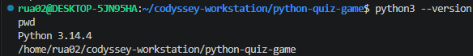
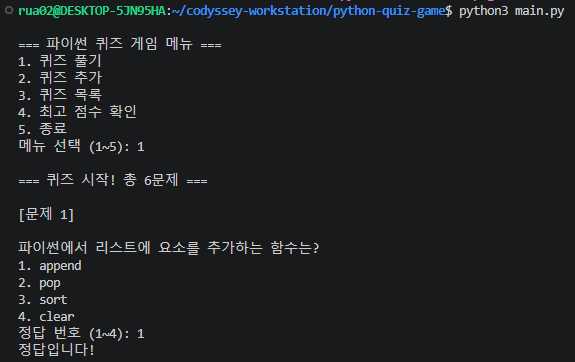
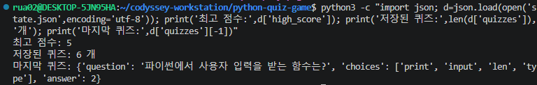
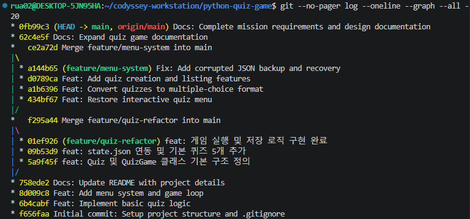

# 🐍 Python 콘솔 퀴즈 게임

Python 기초 문법을 학습하기 위해 제작한 **터미널 기반 4지선다 퀴즈 게임**입니다.

사용자는 퀴즈를 풀거나 직접 문제를 추가할 수 있으며, 등록된 문제와 최고 점수는 JSON 파일에 저장되어 프로그램을 종료한 후에도 유지됩니다.

이 프로젝트는 Python의 기본 문법뿐 아니라 객체 지향 프로그래밍, 예외 처리, 데이터 영속성, Git 버전 관리까지 직접 구현하고 학습하는 것을 목적으로 합니다.

---

## 1. 프로젝트 소개

### 1.1 개발 목적

Python의 문법을 단순히 암기하는 것에서 벗어나 실제로 작동하는 프로그램을 구현하기 위해 제작했습니다.

프로그램을 개발하면서 다음 개념을 학습했습니다.

- 변수, 조건문, 반복문 및 함수
- 클래스와 객체 지향 프로그래밍
- 사용자 입력 검증 및 예외 처리
- JSON을 이용한 데이터 저장과 불러오기
- Git 브랜치 및 커밋 관리
- GitHub를 이용한 코드 공유와 동기화

### 1.2 Python 퀴즈를 주제로 선택한 이유

현재 학습 중인 Python 기초 문법을 퀴즈 문제로 활용하면 프로그램을 구현하는 과정과 실제 학습을 동시에 진행할 수 있다고 판단했습니다.

또한 퀴즈 게임은 문제 출력, 입력, 정답 판정, 점수 계산, 데이터 저장 등 여러 기능을 포함하므로 Python의 핵심 개념을 종합적으로 연습하기에 적절합니다.

---

## 2. 주요 기능

| 기능 | 설명 |
|---|---|
| 퀴즈 풀기 | 4개의 선택지 중 정답 번호를 입력하고 자동 채점 |
| 퀴즈 추가 | 문제, 선택지 4개, 정답 번호를 직접 등록 |
| 퀴즈 목록 | 등록된 문제와 선택지, 정답 확인 |
| 최고 점수 확인 | 기존 최고 점수 조회 |
| JSON 저장 | 문제 목록과 최고 점수를 `state.json`에 저장 |
| 데이터 복원 | 프로그램 재실행 시 저장된 정보 불러오기 |
| 입력 오류 처리 | 빈 입력, 문자 입력, 범위 초과 입력 처리 |
| 안전한 종료 | Ctrl+C 또는 EOF 발생 시 저장을 시도한 뒤 종료 |
| JSON 오류 복구 | 손상 파일 백업 후 기본 문제로 초기화 |

프로그램에는 Python 기초 문법을 주제로 한 **기본 퀴즈 5개**가 제공됩니다.

사용자가 추가한 퀴즈도 저장 파일에 기록되며, 다음 실행 시 다시 불러옵니다.

---

## 3. 개발 환경

| 항목 | 사용 환경 |
|---|---|
| 프로그래밍 언어 | Python 3.10 이상 |
| 개발 및 테스트 환경 | Ubuntu(WSL) |
| 실제 확인한 Python 버전 | Python 3.14.4 |
| 코드 편집기 | Visual Studio Code |
| 버전 관리 | Git, GitHub |
| 데이터 형식 | JSON |
| 외부 패키지 | 사용하지 않음 |

Python 표준 라이브러리인 `json`, `os`, `shutil`, `datetime`을 사용합니다.

별도의 패키지 설치는 필요하지 않습니다.

---

## 4. 프로젝트 구조

```text
python-quiz-game/
├── main.py
├── README.md
├── .gitignore
└── state.json       # 실행 중 생성되는 로컬 데이터
```

### 파일별 역할

| 파일 | 역할 |
|---|---|
| `main.py` | 퀴즈 게임의 전체 기능 구현 |
| `README.md` | 실행 방법, 설계 의도 및 작업 기록 |
| `.gitignore` | Git에서 제외할 파일 설정 |
| `state.json` | 퀴즈 목록과 최고 점수를 저장하는 데이터 파일 |

`state.json`은 개인 실행 데이터를 저장하는 파일로, GitHub 저장소에 포함되지 않아도 프로그램이 동작하도록 설계했습니다.

처음 실행할 때 파일이 존재하지 않으면 기본 퀴즈 5개가 준비되고, 저장 시점에 파일이 생성됩니다.

---

## 5. 실행 방법

### 5.1 GitHub 저장소 복제

터미널에서 다음 명령어를 실행합니다.

```bash
git clone https://github.com/xorua917/python-quiz-game.git
```

### 5.2 프로젝트 폴더로 이동

```bash
cd python-quiz-game
```

### 5.3 Python 버전 확인

```bash
python3 --version
```

Python 3.10 이상이 필요합니다.

### 5.4 프로그램 실행

```bash
python3 main.py
```

### 5.5 실행 화면

```text
=== 파이썬 퀴즈 게임 메뉴 ===
1. 퀴즈 풀기
2. 퀴즈 추가
3. 퀴즈 목록
4. 최고 점수 확인
5. 종료

메뉴 선택 (1~5):
```

사용자는 메뉴 번호를 입력하여 원하는 기능을 실행할 수 있습니다.

### 5.6 퀴즈 진행 예시

```text
=== 퀴즈 시작! 총 5문제 ===

[문제 1]

파이썬에서 리스트에 요소를 추가하는 함수는?
1. append
2. pop
3. sort
4. clear

정답 번호 (1~4): 1
정답입니다!
```

문제를 모두 풀면 총점이 출력되며, 이전 최고 기록보다 점수가 높으면 최고 점수가 갱신됩니다.

---

## 6. 프로그램 설계

프로그램은 `Quiz`와 `QuizGame`이라는 두 개의 클래스로 구성됩니다.

### 6.1 Quiz 클래스

`Quiz` 클래스는 **하나의 퀴즈 문제**를 나타냅니다.

관리하는 데이터는 다음과 같습니다.

- `question`: 문제 내용
- `choices`: 4개의 선택지
- `answer`: 정답 번호(1~4)

주요 메서드는 다음과 같습니다.

| 메서드 | 역할 |
|---|---|
| `__init__()` | 문제와 선택지, 정답의 유효성 확인 및 저장 |
| `display()` | 문제와 선택지 출력 |
| `check_answer()` | 사용자 답변과 정답 비교 |

객체를 생성할 때 문제는 빈 문자열일 수 없으며, 선택지는 정확히 4개여야 합니다. 정답은 1부터 4까지의 정수여야 합니다.

### 6.2 QuizGame 클래스

`QuizGame` 클래스는 **게임 전체의 실행 흐름**을 관리합니다.

| 메서드 | 역할 |
|---|---|
| `__init__()` | 게임 초기화 및 저장 데이터 불러오기 |
| `default_quizzes()` | 기본 퀴즈 5개 생성 |
| `show_menu()` | 메인 메뉴 출력 및 기능 선택 |
| `run()` | 퀴즈 진행, 입력 확인, 점수 계산 |
| `add_quiz()` | 사용자 퀴즈 추가 |
| `list_quizzes()` | 등록된 퀴즈 목록 출력 |
| `load_state()` | JSON 데이터 읽기 및 복구 |
| `save_state()` | JSON 데이터 저장 |

### 6.3 클래스를 분리한 이유

모든 기능을 하나의 함수에 구현하면 프로그램이 커질수록 코드의 흐름을 파악하고 수정하기 어려워집니다.

따라서 개별 문제를 담당하는 `Quiz`와 게임 전체를 관리하는 `QuizGame`으로 역할을 분리했습니다.

이러한 객체 지향 설계는 다음과 같은 장점이 있습니다.

- 문제 데이터와 게임 실행 과정의 책임 분리
- 기능별 코드 수정 및 유지보수 용이
- 새로운 퀴즈 객체를 동일한 구조로 생성 가능
- 정답 판정 기능의 재사용 가능

작은 프로그램에서는 함수만 사용하는 방식도 가능하지만, 이번 미션에서는 클래스의 역할과 객체 간 관계를 직접 학습하기 위해 클래스 기반 설계를 선택했습니다.

---

## 7. 사용자 입력 검증과 파일 입출력의 분리

### 7.1 입력 검증

메뉴 선택과 정답 입력은 `show_menu()` 및 `run()`에서 처리합니다.

새로운 문제 입력은 `add_quiz()`에서 처리합니다.

입력 검증 과정에서는 `.strip()`으로 앞뒤 공백을 제거하고, 필요한 경우 정수 변환 및 범위 확인을 수행합니다.

예를 들어 정답 입력 시 다음 상황을 처리합니다.

| 입력 상황 | 프로그램 동작 |
|---|---|
| `1` | 정상적인 정답 입력 |
| ` 2 ` | 앞뒤 공백 제거 후 처리 |
| 빈 입력 | 다시 입력 요청 |
| `abc` | 숫자 입력 안내 |
| `0` | 허용 범위 안내 |
| `5` | 허용 범위 안내 |
| `Ctrl+C` | 저장을 시도하고 종료 |
| EOF | 저장을 시도하고 종료 |

입력 오류가 발생하더라도 잘못된 값을 정답으로 처리하지 않고 다시 입력받도록 구성했습니다.

### 7.2 파일 입출력

파일 읽기와 쓰기는 다음 메서드에서 담당합니다.

- `load_state()`: JSON 파일 읽기 및 데이터 검증
- `save_state()`: JSON 파일 쓰기 및 저장 실패 처리

사용자 입력 처리와 파일 입출력을 분리하면, 입력 방식 또는 데이터 저장 방식을 변경할 때 수정할 부분을 명확하게 구분할 수 있습니다.

---

## 8. JSON 데이터 저장 구조

### 8.1 state.json 예시

```json
{
  "high_score": 5,
  "quizzes": [
    {
      "question": "파이썬 파일의 확장자는?",
      "choices": [
        ".txt",
        ".py",
        ".json",
        ".exe"
      ],
      "answer": 2
    }
  ]
}
```

위 내용은 전체 저장 구조를 설명하기 위한 축약 예시입니다.

### 8.2 필드별 의미

| 필드 | 자료형 | 설명 |
|---|---|---|
| `high_score` | 정수 | 지금까지 기록한 최고 점수 |
| `quizzes` | 배열 | 저장된 퀴즈 목록 |
| `question` | 문자열 | 퀴즈 문제 |
| `choices` | 문자열 배열 | 4개의 선택지 |
| `answer` | 정수 | 정답 번호 1~4 |

`quizzes`를 배열로 구성한 이유는 여러 문제를 순서대로 저장하고 반복 처리하기 위해서입니다.

각 문제는 하나의 객체로 구성하여 문제, 선택지, 정답을 함께 관리합니다.

선택지를 문자열 배열로 구성하면 순서를 유지하면서 번호를 붙여 출력할 수 있습니다.

### 8.3 데이터 불러오기 과정

프로그램 시작 시 다음 순서로 실행됩니다.

```text
프로그램 실행
    ↓
QuizGame 객체 생성
    ↓
__init__()
    ↓
load_state()
    ↓
state.json 존재 여부 확인
    ↓
저장된 데이터 복원 또는 기본 퀴즈 생성
    ↓
메인 메뉴 출력
```

### 8.4 데이터 저장 시점

| 상황 | 저장 과정 |
|---|---|
| 퀴즈 추가 | `add_quiz()` → `save_state()` |
| 게임 완료 | `run()` → 점수 갱신 → `save_state()` |
| 메뉴에서 종료 | `show_menu()` → `save_state()` |
| Ctrl+C 또는 EOF | 예외 처리 → `save_state()` 호출 |

퀴즈 도중 강제 종료되는 경우에는 완료되지 않은 게임의 임시 점수를 기록하지 않습니다. 이전에 저장된 문제와 최고 점수를 유지하도록 설계했습니다.

### 8.5 JSON을 선택한 이유

JSON을 선택한 이유는 다음과 같습니다.

- 사람이 직접 내용을 읽고 확인할 수 있음
- Python 표준 라이브러리만으로 읽기와 쓰기가 가능함
- 문제, 선택지, 점수를 계층적인 구조로 저장할 수 있음
- 소규모 콘솔 프로그램에 별도 데이터베이스 서버가 필요하지 않음

### 8.6 JSON의 한계와 대안

현재 프로그램은 저장된 퀴즈를 메모리에 불러오고 전체 내용을 JSON 파일로 저장합니다.

따라서 문제 수가 크게 증가하면 메모리 사용량과 저장 비용이 증가할 수 있습니다.

또한 여러 사용자가 동시에 데이터를 변경하거나, 특정 문제만 빈번하게 수정하는 상황에는 단일 JSON 파일 방식이 적절하지 않을 수 있습니다.

프로젝트 규모가 커지면 **SQLite**와 같은 데이터베이스를 도입하여 데이터를 체계적으로 관리하는 방식을 고려할 수 있습니다.

---

## 9. 예외 처리 및 오류 복구

### 9.1 사용자 입력 오류

메뉴 번호 또는 정답 번호가 올바르지 않으면 오류 안내를 출력하고 다시 입력받습니다.

문제와 선택지를 추가할 때 빈 문자열을 입력하면 재입력을 요청합니다.

또한 사용자 입력 중 `KeyboardInterrupt` 또는 `EOFError`가 발생하면 종료 메시지를 출력하고 저장을 시도합니다.

### 9.2 JSON 파일 오류

`load_state()`는 다음과 같은 상황을 처리하도록 구성했습니다.

- JSON 문법 오류
- 파일 읽기 오류
- 필수 필드 누락
- 잘못된 데이터 자료형
- 허용되지 않는 정답 번호
- 손상되었거나 변환할 수 없는 기존 퀴즈 데이터

오류가 발생하면 가능한 경우 기존 파일을 백업한 후 기본 퀴즈로 시작합니다.

### 9.3 손상된 JSON 파일의 백업

저장 파일이 손상되면 다음 순서로 처리합니다.

```text
state.json 읽기
    ↓
데이터 오류 감지
    ↓
손상된 원본 파일 별도 백업
    ↓
백업 성공 여부 확인
    ↓
기본 퀴즈 5개로 초기화
    ↓
프로그램 실행
```

백업 파일 이름은 다음 형태로 생성됩니다.

```text
state.json.corrupt-YYYYMMDD-HHMMSS-ffffff.bak
```

백업에 성공한 경우에는 기존 원본을 별도 파일로 보존한 채 기본 데이터로 재시작합니다.

백업에 실패한 경우에는 손상된 원본이 덮어써지는 일을 방지하기 위해 저장을 차단합니다.

**주의:** 이 기능은 손상된 데이터를 자동으로 원상 복원하는 기능이 아니라, 손상된 원본을 보존하면서 프로그램 실행을 복구하는 기능입니다.

### 9.4 파일 저장 오류

`save_state()`는 파일 쓰기 과정에서 발생하는 `OSError`를 처리합니다.

저장 성공 여부를 `True` 또는 `False`로 반환하며, 저장에 실패하면 안내 메시지를 출력합니다.

다만 현재 방식은 일반적인 파일 쓰기를 사용하므로 저장 도중 시스템이 갑자기 중단되는 상황까지 완전히 보호하지는 못합니다.

향후에는 임시 파일에 먼저 데이터를 저장한 뒤 원본 파일을 교체하는 **원자적 저장 방식**을 적용할 수 있습니다.

---

## 10. Git 버전 관리

### 10.1 Git 사용 목적

Git을 사용하여 개발 과정에서 발생한 변경 사항을 기록하고, 기능별 개발 이력을 관리했습니다.

GitHub는 원격 저장소로 사용하여 로컬 작업 내용의 업로드와 동기화를 실습했습니다.

### 10.2 커밋 작성 원칙

커밋은 기능이나 수정 목적에 따라 의미 있는 단위로 나누어 작성했습니다.

| 접두사 | 의미 | 예시 |
|---|---|---|
| `Feat:` | 새로운 기능 구현 | 객관식 퀴즈 전환 |
| `Fix:` | 오류 수정 및 안정성 개선 | 손상 JSON 복구 |
| `Docs:` | 문서 작성 및 수정 | README 보완 |

가능하면 서로 다른 목적의 변경 사항을 하나의 커밋으로 묶지 않고, 수정한 이유를 알 수 있는 메시지를 작성하도록 했습니다.

### 10.3 주요 커밋 기록

| 커밋 | 작업 내용 |
|---|---|
| `f656faa` | 프로젝트 초기 설정 |
| `6b4cabf` | 기본 퀴즈 로직 구현 |
| `8d009c8` | 메뉴 시스템 구현 |
| `5a9f45f` | Quiz 및 QuizGame 클래스 구조 작성 |
| `09b53d9` | JSON 연동과 기본 퀴즈 추가 |
| `01ef926` | 게임 실행 및 저장 로직 구현 |
| `434bf67` | 대화형 메뉴 복원 |
| `a1b6396` | 4지선다 퀴즈 전환 |
| `d0789ca` | 퀴즈 추가 및 목록 기능 |
| `a144b65` | JSON 오류 백업 및 복구 |
| `62c4e5f` | 프로젝트 README 확장 |

기능 개발 커밋 외에도 브랜치 병합 커밋과 문서 수정 커밋이 기록되어 있습니다.

개발 이력은 다음 명령어로 확인할 수 있습니다.

```bash
git --no-pager log --oneline --graph --all -20
```

### 10.4 브랜치 전략

`main` 브랜치는 검증된 코드를 관리하는 기준 브랜치입니다.

새로운 기능은 별도 브랜치에서 개발한 뒤, 실행 테스트를 거쳐 `main`에 병합했습니다.

실제로 사용한 기능 브랜치는 다음과 같습니다.

| 브랜치 | 주요 작업 |
|---|---|
| `feature/quiz-refactor` | 클래스 분리 및 JSON 저장 |
| `feature/menu-system` | 메뉴 복원, 객관식 전환, 문제 관리, JSON 오류 복구 |

두 브랜치는 `git merge --no-ff` 방식으로 병합하여 기능 개발 흐름을 커밋 이력에 남겼습니다.

### 10.5 브랜치 병합

주요 병합 커밋은 다음과 같습니다.

- `f295a44` — `feature/quiz-refactor` 병합
- `ce2a72d` — `feature/menu-system` 병합

실제 작업에서는 병합 충돌 없이 정상적으로 병합됐습니다.

### 10.6 병합 충돌 해결 방법

여러 브랜치에서 같은 파일의 동일한 부분을 수정하면 충돌이 발생할 수 있습니다.

충돌 발생 시에는 다음 순서로 대응합니다.

1. `git status`로 충돌이 발생한 파일 확인
2. 파일의 충돌 표시와 양쪽 변경 사항 확인
3. 필요한 내용을 선택하거나 통합
4. 충돌 표시를 제거하고 코드 실행 검증
5. `git add`로 해결한 파일 등록
6. `git commit`으로 병합 완료

이번 프로젝트에서는 실제 충돌이 발생하지 않았으므로 위 절차는 충돌 발생 시 적용할 해결 계획입니다.

### 10.7 Clone·Commit·Push·Pull 실습

GitHub 저장소를 별도 디렉터리에 복제하고, 복제본에서 README를 수정한 뒤 원래 프로젝트에 반영하는 과정을 수행했습니다.

**원래 프로젝트 폴더**

```text
~/codyssey-workstation/python-quiz-game
```

**복제 프로젝트 폴더**

```text
~/codyssey-clone-test/python-quiz-game
```

실습 과정은 다음과 같습니다.

1. GitHub 저장소를 별도 디렉터리에 Clone
2. 복제된 저장소의 README 수정
3. 수정 사항 Commit
4. 복제 저장소에서 GitHub로 Push
5. 원래 저장소로 이동
6. GitHub의 최신 변경 사항 Pull
7. 두 저장소의 최신 커밋 일치 여부 확인

복제에 사용한 명령어:

```bash
git clone https://github.com/xorua917/python-quiz-game.git
```

복제 저장소에서 수행한 주요 명령어:

```bash
git add README.md
git commit -m "Docs: Expand quiz game documentation"
git push origin main
```

원래 프로젝트에서 수행한 명령어:

```bash
git pull --ff-only origin main
git log -1 --oneline
git status -sb
```

이 과정을 통해 서로 다른 로컬 작업 폴더가 동일한 GitHub 저장소를 기준으로 변경 사항을 공유할 수 있음을 확인했습니다.

---

## 11. 요구사항 변경 시 수정 위치

프로그램의 기능을 변경해야 할 때 다음 위치를 기준으로 수정할 수 있습니다.

| 변경하려는 기능 | 수정 대상 |
|---|---|
| 기본 문제 내용 | `default_quizzes()` |
| 퀴즈 데이터 구조 | `Quiz.__init__()` |
| 문제 및 선택지 출력 | `Quiz.display()` |
| 정답 판정 방식 | `Quiz.check_answer()` |
| 메뉴 구성 | `QuizGame.show_menu()` |
| 퀴즈 진행과 입력 검증 | `QuizGame.run()` |
| 문제 추가 방식 | `QuizGame.add_quiz()` |
| 문제 목록 출력 | `QuizGame.list_quizzes()` |
| JSON 불러오기 및 복구 | `QuizGame.load_state()` |
| JSON 저장 방식 | `QuizGame.save_state()` |

예를 들어 문제당 선택지를 4개에서 5개로 변경하려면 다음 요소들을 함께 수정해야 합니다.

- `Quiz` 클래스의 선택지 개수와 정답 검증
- 기본 퀴즈의 선택지 구성
- 사용자 입력의 허용 범위
- 퀴즈 추가 기능의 입력 개수
- 기존 JSON 저장 데이터와의 호환성

이처럼 기능 간 영향을 함께 검토하면 요구사항이 변경되더라도 기존 기능이 손상되는 일을 줄일 수 있습니다.

---

## 12. 테스트 및 검증

### 12.1 Python 문법 검사

```bash
python3 -m py_compile main.py
```

문법 검사를 통해 코드가 정상적으로 해석되는지 확인했습니다.

### 12.2 주요 기능 테스트

| 테스트 항목 | 확인 결과 |
|---|---|
| 기본 퀴즈 5개 출력 | 성공 |
| 문제당 선택지 4개 출력 | 성공 |
| 정답 번호 입력 및 채점 | 성공 |
| 퀴즈 추가 | 성공 |
| 등록된 퀴즈 목록 확인 | 성공 |
| 최고 점수 갱신 | 성공 |
| 프로그램 재실행 후 최고 점수 복원 | 성공 |
| 추가한 퀴즈 데이터 유지 | 성공 |
| 잘못된 메뉴 번호 입력 | 성공 |
| 퀴즈 진행 중 Ctrl+C 종료 | 성공 |
| 손상된 임시 JSON 파일 백업 | 성공 |
| 기본 퀴즈 복구 및 재저장 | 성공 |
| Git 브랜치 병합 | 성공 |
| Clone·Commit·Push·Pull | 성공 |

### 12.3 JSON 복구 테스트

실제 `state.json` 대신 임시 디렉터리에 손상된 JSON 파일을 생성하여 복구 동작을 검증했습니다.

테스트에서는 다음 사항을 확인했습니다.

- 손상된 JSON 감지
- 원본 내용을 포함한 백업 파일 생성
- 기본 퀴즈 5개 복구
- 최고 점수 0점으로 초기화
- 복구된 JSON 재저장
- 실제 로컬 `state.json` 파일 보호

### 12.4 추가 검증이 필요한 사항

아직 별도의 자동 테스트로 검증하지 않은 항목도 있습니다.

- EOF 입력의 독립적인 테스트
- 파일 접근 권한 오류
- JSON 필드별 비정상 값
- 다양한 숫자 입력 경계값
- 저장 도중 시스템 중단 상황

향후 테스트 범위를 넓혀 프로그램의 안정성을 개선할 계획입니다.

---

## 13. 평가 증빙 자료

미션 수행 과정에서는 다음 내용을 증빙 대상으로 활용할 수 있습니다.

- Python 개발 환경 및 버전 확인 화면
- 4지선다 퀴즈 실행 및 채점 화면
- 퀴즈 추가 및 목록 조회 화면
- `state.json` 저장 내용
- 최고 점수 재실행 복원 화면
- 손상 JSON 백업·복구 테스트 결과
- Git 커밋 및 브랜치 병합 이력
- Clone·Push·Pull 실행 기록

Git 이력 확인 명령어:

```bash
git --no-pager log --oneline --graph --all -20
git branch -a
git status -sb
```

※ 위 항목은 증빙 대상으로 정리한 목록이며, 실제 스크린샷 파일의 첨부 및 제출 여부는 별도로 확인해야 합니다.

---

## 14. 향후 개선 사항

현재 필수 기능 외에 다음 기능을 추가할 수 있습니다.

- 퀴즈 수정 및 삭제 기능
- 문제 순서 무작위 출제
- 오답 문제 다시 풀기
- 사용자별 점수 관리
- JSON 저장의 원자성 강화
- 자동화 테스트 도입
- SQLite 기반 데이터 관리

이러한 기능은 현재 구현된 기본 퀴즈 게임을 확장하기 위한 개선 방향입니다.

---

## 15. 프로젝트 저장소

**GitHub:** https://github.com/xorua917/python-quiz-game

Python과 Git을 활용하여 기초 문법 학습부터 실제 프로그램 구현, 데이터 저장, 버전 관리까지 경험한 프로젝트입니다.

---

## 16. 실행 화면 증빙

### 16.1 Python 개발 환경



### 16.2 4지선다 퀴즈 실행



### 16.3 JSON 데이터 저장



### 16.4 Git 커밋 및 브랜치 병합


